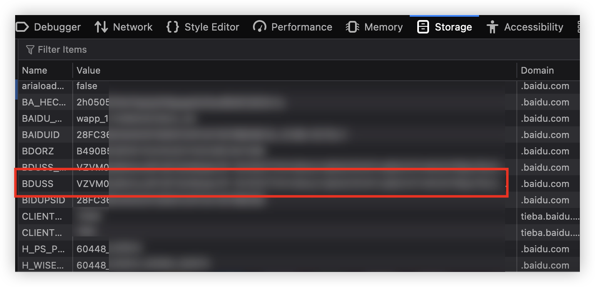
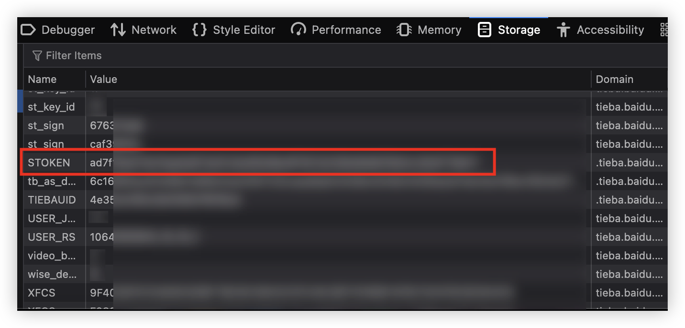

# All_Tieba_Sign_Mobile

获取所有关注的贴吧，并模拟手机端自动签到。

通过翻页抓取「我关注的吧」拿到全量列表，因此不受官方接口 200 条的限制。

## 使用

```bash
pip install requests beautifulsoup4

# 填凭据（二选一）
cp .env.example .env                       # 编辑 .env 填入 BDUSS / STOKEN
export TIEBA_BDUSS=... TIEBA_STOKEN=...    # 或者用环境变量

python3 main.py           # 更新列表 + 签到
python3 main.py refresh   # 只更新 tieba.json
python3 main.py sign      # 只签到（不需要 STOKEN）
```

不填凭据直接运行，脚本会提示输入。

`tieba.json` 是本地增量缓存（不纳入版本库）：抓取不完整时只增不删，写入前自动备份 `.bak`。

常用选项：`--no-prune`（永不删除）、`--report run.json`（运行摘要）、`-v`（详细日志）。

## 测试

```bash
python3 -m unittest test_main -v
```

## 运行效果





---

> 本 README 由 AI 助手（DeepSeek Harness）撰写。
